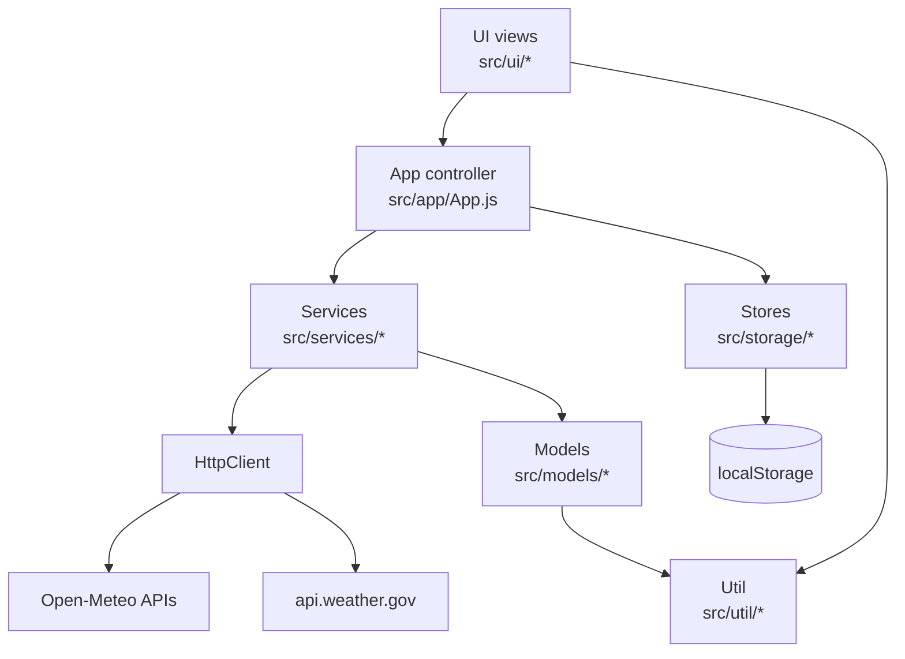
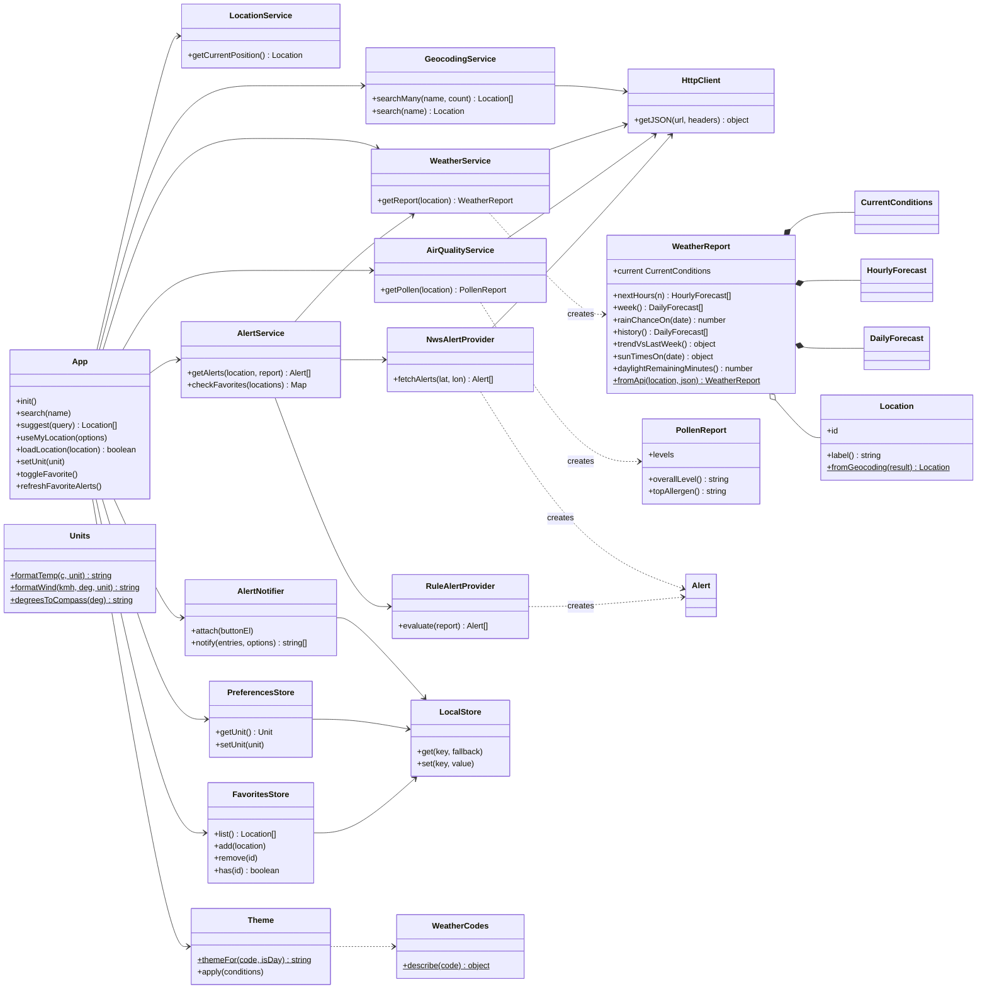
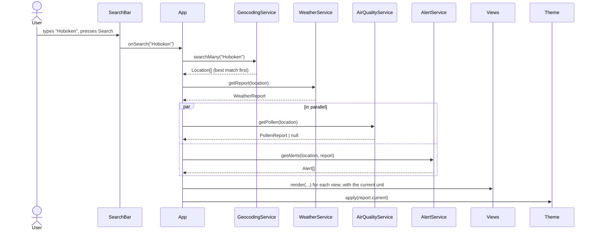

# Architecture

This doc describes how the Weather Web App is organized: the folders, the classes, what each class's methods do, and which user story each piece serves. Use it to find where your story's code goes.

Stories are numbered as in [BACKLOG.md](BACKLOG.md) (US-01 to US-13).

## 1. Overview

- **Static site.** Plain HTML, CSS, and JavaScript ES modules. There's no framework, bundler, or build step, and no backend.
- **Data sources.** [Open-Meteo](https://open-meteo.com/) provides forecast, geocoding, and air quality (pollen). The [US National Weather Service API](https://www.weather.gov/documentation/services-web-api) provides official alerts for US locations. None of these need an API key.
- **Persistence.** The browser's `localStorage` holds the unit choice and favorite locations. There are no user accounts.
- **Consequence of no backend.** Severe weather alerts are only checked while the app is open in a tab. There are no push notifications when the app is closed.

## 2. Layers



| Layer | Folder | Job | Touches the DOM? |
|-------|--------|-----|------------------|
| UI | `src/ui/` | Render data into elements and forward user events | Yes |
| Controller | `src/app/` | Own app state and call services, then tell views to render | Yes, but only through views |
| Services | `src/services/` | Call APIs and turn JSON into models | No |
| Models | `src/models/` | Plain data classes with query methods (for example, "rain chance on this date") | No |
| Storage | `src/storage/` | Read and write `localStorage` | No |
| Util | `src/util/` | Pure helpers: unit conversion and weather code lookup | No |

Everything outside `src/ui/` and `src/app/` must run in Node, so `npm test` can cover it.

## 3. Directory structure

```
SSW-555_WeatherWebApp/
├── index.html                  Page markup: one <section> per view (ids listed in §5.7)
├── package.json                npm start (serve .), npm test (node --test)
├── README.md
├── docs/
│   ├── ARCHITECTURE.md         This file
│   └── BACKLOG.md              Product backlog and sprint plan
├── styles/
│   ├── main.css                Layout, typography, components
│   └── themes.css              Background gradients per weather theme (US-13)
└── src/
    ├── main.js                 Entry point: builds the services and stores, then calls new App(...).init()
    ├── app/
    │   └── App.js
    ├── models/
    │   ├── Location.js
    │   ├── CurrentConditions.js
    │   ├── HourlyForecast.js
    │   ├── DailyForecast.js
    │   ├── WeatherReport.js
    │   ├── WeatherReport.test.js
    │   ├── PollenReport.js
    │   ├── PollenReport.test.js
    │   └── Alert.js
    ├── services/
    │   ├── HttpClient.js
    │   ├── HttpClient.test.js
    │   ├── GeocodingService.js
    │   ├── GeocodingService.test.js
    │   ├── LocationService.js
    │   ├── WeatherService.js
    │   ├── WeatherService.test.js
    │   ├── AirQualityService.js
    │   ├── AlertService.js
    │   ├── AlertService.test.js
    │   ├── NwsAlertProvider.js
    │   ├── RuleAlertProvider.js
    │   └── RuleAlertProvider.test.js
    ├── storage/
    │   ├── LocalStore.js
    │   ├── PreferencesStore.js
    │   ├── FavoritesStore.js
    │   └── FavoritesStore.test.js
    ├── util/
    │   ├── Units.js
    │   ├── Units.test.js
    │   ├── Dates.js
    │   ├── Dates.test.js
    │   ├── WeatherCodes.js
    │   └── WeatherCodes.test.js
    ├── testing/                Test helpers only, never imported by the app
    │   ├── forecastFixture.js  Builds fake Open-Meteo forecast responses
    │   └── fakeStorage.js      In-memory stand-in for localStorage
    └── ui/
        ├── Theme.js
        ├── Theme.test.js       Tests the pure themeFor() only
        ├── SearchBar.js
        ├── OtherMatchesView.js
        ├── StatusView.js
        ├── UnitToggle.js
        ├── CurrentWeatherView.js
        ├── HourlyView.js
        ├── WeeklyView.js
        ├── RainChanceView.js
        ├── HistoryView.js
        ├── SunView.js
        ├── PollenView.js
        ├── AlertBanner.js
        └── FavoritesView.js
```

`index.html` loads the app with `<script type="module" src="src/main.js"></script>` and links both stylesheets.

### Migration from the original scaffold

The foundation PR (branch `US-00-src-foundation`) moved the original flat files into this layout and deleted them. This table is kept so you can find where old code went.

| Was | Now |
|-------|----------|
| `weather.js` `getJSON()` | `HttpClient.getJSON()` |
| `weather.js` `geocode()` | `GeocodingService.search()` |
| `weather.js` `getCurrent()` | `WeatherService.getReport()` (current conditions become `report.current`) |
| `weather.js` `describe()` + `CODES` | `WeatherCodes.describe()` |
| `weather.test.js` | Split into `WeatherCodes.test.js` and `GeocodingService.test.js` |
| `app.js` form handler | `SearchBar` + `App.loadLocation()` |
| `app.js` `render()` | `CurrentWeatherView.render()` |
| `style.css` | `styles/main.css` |

## 4. Conventions

### Files and naming
- **One class per file.** The file is named after the class in PascalCase (`WeatherService.js` exports `WeatherService`). The only lowercase file is the entry point, `main.js`.
- **Named exports only.** Use `export class WeatherService {}`, not `export default`, so imports and file names always match.
- **Tests sit next to the code** as `<ClassName>.test.js`. `node --test` finds them automatically.
- **Shared test helpers go in `src/testing/`.** The folder is deliberately not named `test/`, because `node --test` would run every file inside a `test/` folder as a test.
- **Folders are lowercase and plural**, except `app/`, `util/`, and `testing/`.

### Code style
- Write import paths as relative paths **with the `.js` extension** (`import { Units } from '../util/Units.js'`). Browsers need the extension to load modules.
- Use `#private` fields for internal state. Public methods are the ones listed in §5.
- Use `async`/`await` for anything that hits the network.
- 2-space indent, single quotes, and semicolons, matching the scaffold.

### Data rules
- **Models store metric values only:** °C, km/h, and mm. Convert to °F or mph at render time with `Units`. This means a unit switch only re-renders and never re-fetches.
- **Times stay as the ISO strings Open-Meteo returns**, in the location's own time zone (`timezone=auto`). Dates are `YYYY-MM-DD` strings. Don't convert them to the viewer's time zone.
- **Location ids** are `"<lat>,<lon>"` rounded to 2 decimals (for example, `"40.74,-74.03"`). That way searched and geolocated places use the same key format.

### Browser APIs and dependency injection
- `fetch`, `localStorage`, `navigator.geolocation`, and `document` are only read as **default constructor arguments**. For example, `new LocalStore(storage = globalThis.localStorage)` lets tests pass a fake.
- `src/main.js` is the one place that creates every object and wires them together.

### Errors
- Services throw `Error` with a **message a user can read**, such as "No city found for "Atlantis"." or "Network error. Check your connection and try again."
- `App` catches errors and shows `err.message` through `StatusView`: a red `role="alert"` box (`#search-error`) that screen readers announce. Loading text goes in the polite `#status` region. Views never catch errors themselves.

### CSS and HTML
- Each view's root element has an id in kebab-case that matches the class: `CurrentWeatherView` → `#current-weather`.
- CSS classes are kebab-case.
- The weather theme is set on `<body data-theme="rain-day">`, and `themes.css` holds one rule per theme.

### localStorage keys
These are all prefixed `weather:`.

| Key | Value |
|-----|-------|
| `weather:unit` | `"C"` or `"F"` |
| `weather:favorites` | JSON array of `Location` objects |
| `weather:seenAlerts` | JSON array of the last 200 alert ids already notified (US-07) |
| `weather:lastLocation` | The last location the browser detected, as a `Location` object (US-04) |

### Git
- Branch per story, named `US-<id>-<short-name>`, for example `US-07-alerts`. Open the PR title with the story id.

## 5. Class reference

Types in signatures: `Unit` is `'C' | 'F'`. `ISODate` is `'YYYY-MM-DD'`. `ISODateTime` is `'YYYY-MM-DDTHH:mm'`.

### 5.1 Models (`src/models/`)

#### `Location`
A place the app can show weather for.

| Member | Description |
|--------|-------------|
| `constructor({ name, region, country, countryCode, latitude, longitude })` | `region` (state/province) and `country`/`countryCode` may be `null` for geolocated places |
| `id` (getter) | `"lat,lon"` rounded to 2 decimals |
| `label()` | `"Hoboken, New Jersey, United States"`, skipping empty parts |
| `static fromGeocoding(result)` | Builds from an Open-Meteo geocoding result (`name`, `admin1`, `country`, `country_code`, `latitude`, `longitude`) |
| `toJSON()` / `static fromJSON(obj)` | For `FavoritesStore` |

#### `CurrentConditions`
Fields: `time`, `temperatureC`, `feelsLikeC`, `humidity`, `windKmh`, `windDirectionDeg`, `weatherCode`, `isDay` (boolean).

#### `HourlyForecast`
Fields: `time`, `temperatureC`, `precipChance` (0–100), `weatherCode`.

#### `DailyForecast`
Fields: `date`, `highC`, `lowC`, `weatherCode`, `precipChanceMax`, `sunrise`, `sunset`, `gustMaxKmh`.

#### `WeatherReport`
Everything from one forecast request: current conditions, 7 past days, today, and 15 days ahead.

| Method | Returns | Story |
|--------|---------|-------|
| `static fromApi(location, json)` | `WeatherReport`, built from the Open-Meteo forecast response | — |
| `location`, `timezone`, `current` | `Location`, `string`, `CurrentConditions` | US-01, US-08 |
| `today()` | `ISODate` for the location's current date (taken from `current.time`) | — |
| `nextHours(n = 24)` | `HourlyForecast[]` starting at the current hour | US-02 |
| `week()` | `DailyForecast[]` for 7 days starting today | US-03 |
| `rainChanceOn(date)` | `number` (0–100), or `null` if the date isn't between today and today + 15 | US-09 |
| `forecastRange()` | `{ min: ISODate, max: ISODate }`, used to limit the date picker | US-09 |
| `history()` | `DailyForecast[]` for the 7 days before today | US-10 |
| `trendVsLastWeek()` | `{ avgHighThisWeekC, avgHighLastWeekC, differenceC }` | US-10 |
| `sunTimesOn(date = today())` | `{ sunrise, sunset }` (`ISODateTime`) | US-12 |
| `daylightRemainingMinutes()` | Minutes from `current.time` to today's sunset. Returns 0 after sunset. | US-12 |

#### `PollenReport`

| Member | Description | Story |
|--------|-------------|-------|
| `static fromApi(json)` | Returns `null` when every pollen value is `null` (this happens outside Europe) | US-11 |
| `time`, `levels` | `levels` is `{ alder, birch, grass, mugwort, olive, ragweed }` in grains/m³ | US-11 |
| `overallLevel()` | `'Low' \| 'Moderate' \| 'High'` based on the highest value. The thresholds are in a `LEVELS` constant. | US-11 |
| `topAllergen()` | Name of the pollen type with the highest value | US-11 |

#### `Alert`
Fields: `id` (the NWS alert id, or `forecast:<locationId>:<rule>:<date>` for rule alerts), `title`, `severity` (`'Extreme' | 'Severe' | 'Moderate' | 'Minor'`, the same scale NWS uses; anything else becomes `'Minor'`), `headline` (one line for the banner), `description`, `starts`, `ends`, `source` (`'NWS' | 'forecast'`).

`static compare(a, b)` sorts the most severe first.

### 5.2 Services (`src/services/`)

#### `HttpClient`

| Method | Description |
|--------|-------------|
| `constructor(fetchFn = globalThis.fetch)` | |
| `getJSON(url, headers = {})` | Throws "Network error…" when fetch fails, and "Weather service is unavailable…" on a non-2xx status. Same messages as the scaffold. |

#### `GeocodingService` (US-05)

| Method | Description |
|--------|-------------|
| `constructor(http)` | |
| `searchMany(name, count = 5)` → `Location[]` | `geocoding-api.open-meteo.com/v1/search?count=…&language=en&name=…`, best match first. Skips results without valid coordinates and lists places with the same id once. Understands `"City, State, Country"`: it searches the city name (Open-Meteo matches names only) and moves results whose state, country, or country code match the rest to the front. Throws `Type a city name to search.` for an empty name and `No city found for "<name>".` when nothing matches. |
| `search(name)` → `Location` | The best match only (`searchMany(name, 1)`). |

#### `LocationService` (US-04)

| Method | Description |
|--------|-------------|
| `constructor(geolocation = globalThis.navigator?.geolocation)` | |
| `getCurrentPosition()` → `Location` | Wraps `geolocation.getCurrentPosition` in a Promise (10 s timeout; a position up to 10 minutes old is reused). Returns a `Location` named "Your location" with no country, since Open-Meteo has no reverse geocoding. Rejects with an `Error` whose `code` is `denied`, `unavailable`, `timeout`, or `unsupported`, and whose message a user can read, such as "Location access was denied." |

#### `WeatherService` (US-01, 02, 03, 08, 09, 10, 12)

| Method | Description |
|--------|-------------|
| `constructor(http)` | |
| `getReport(location)` → `WeatherReport` | **One request** to `api.open-meteo.com/v1/forecast` with the parameters below |

```
timezone=auto&past_days=7&forecast_days=16
&current=temperature_2m,apparent_temperature,relative_humidity_2m,wind_speed_10m,wind_direction_10m,weather_code,is_day
&hourly=temperature_2m,precipitation_probability,weather_code
&daily=temperature_2m_max,temperature_2m_min,weather_code,precipitation_probability_max,sunrise,sunset,wind_gusts_10m_max
```

#### `AirQualityService` (US-11)

| Method | Description |
|--------|-------------|
| `constructor(http)` | |
| `getPollen(location)` → `PollenReport \| null` | `air-quality-api.open-meteo.com/v1/air-quality?current=alder_pollen,birch_pollen,grass_pollen,mugwort_pollen,olive_pollen,ragweed_pollen`. **Only Europe has data.** Elsewhere it returns `null` and the view says "Pollen data isn't available for this location." |

#### `AlertService` (US-07)
Decides which alert source to use.

| Method | Description |
|--------|-------------|
| `constructor(nwsProvider, ruleProvider, weatherService)` | |
| `getAlerts(location, report)` → `Alert[]` | If `location.countryCode` is `'US'` or unknown (geolocated), it tries NWS. For any other country, or if NWS throws (it returns HTTP 400 "out of bounds" outside the US), it uses `ruleProvider.evaluate(report)`. |
| `checkFavorites(locations)` → `Map` of location id → `Alert[]` | Fetches a report and alerts for each saved location in parallel. `App` calls this on load and every 15 minutes. |

#### `NwsAlertProvider`

| Method | Description |
|--------|-------------|
| `constructor(http)` | |
| `fetchAlerts(lat, lon)` → `Alert[]` | `api.weather.gov/alerts/active?point=<lat>,<lon>` (coordinates rounded to 4 decimals, header `Accept: application/geo+json`). Each `features[].properties` maps to `Alert`: `event` → `title`, `severity`, `description`, `onset` → `starts`, and `ends ?? expires` → `ends`. |

#### `RuleAlertProvider`
This is the fallback outside the US. It flags dangerous conditions in the next 3 days of the forecast. These are **not official warnings**, so the banner labels them "Forecast alert".

| Method | Description |
|--------|-------------|
| `evaluate(report)` → `Alert[]` | Applies the thresholds below and returns at most one alert per rule, for the first day it applies. The values (including `daysAhead: 3`) live in an exported `THRESHOLDS` constant so the team can tune them. |

| Rule | Condition (any of the next 3 days) | Severity |
|------|-----------------------------------|----------|
| Thunderstorm | `weatherCode` 95, 96, or 99 | Severe |
| High wind | `gustMaxKmh` ≥ 75 | Severe |
| Extreme heat | `highC` ≥ 35 | Severe |
| Extreme cold | `lowC` ≤ −15 | Severe |
| Heavy snow | `weatherCode` 75 or 86 | Moderate |

### 5.3 Storage (`src/storage/`)

#### `LocalStore`

| Method | Description |
|--------|-------------|
| `constructor(storage = globalThis.localStorage, prefix = 'weather:')` | |
| `get(key, fallback)` | Parses JSON, and returns `fallback` when the value is missing or corrupt |
| `set(key, value)` | Stores the value as JSON |

#### `PreferencesStore` (US-01, US-04)

| Method | Description |
|--------|-------------|
| `constructor(store)` | Takes a `LocalStore` |
| `getUnit()` → `Unit` | Default `'F'` |
| `setUnit(unit)` | Throws if the unit isn't `'C'` or `'F'` |
| `getLastLocation()` → `Location \| null` | The last detected location; `null` if none is saved or it's invalid (US-04) |
| `setLastLocation(location)` | Saves a detected location (US-04) |

#### `FavoritesStore` (US-06)

| Method | Description |
|--------|-------------|
| `constructor(store)` | Takes a `LocalStore` |
| `list()` → `Location[]` | In the order they were saved |
| `add(location)` | Does nothing if the location is already saved |
| `remove(id)` | |
| `has(id)` → `boolean` | |

### 5.4 Util (`src/util/`)

#### `Units` (static, US-01, US-08)

| Method | Example |
|--------|---------|
| `cToF(c)` | `cToF(20)` → `68` |
| `kmhToMph(kmh)` | `kmhToMph(16.09)` → `10` |
| `temp(c, unit)` | `temp(13.7, 'F')` → `57` (rounded number, never `-0`) |
| `formatTemp(c, unit)` | `formatTemp(13.7, 'F')` → `"57°F"` |
| `formatSpeed(kmh, unit)` | `formatSpeed(18.8, 'F')` → `"12 mph"` |
| `formatWind(kmh, deg, unit)` | `formatWind(18.8, 331, 'F')` → `"12 mph NNW"` |
| `degreesToCompass(deg)` | `degreesToCompass(331)` → `"NNW"` (16 points) |

#### `Dates` (static)
Helpers for Open-Meteo's `YYYY-MM-DD` strings. The math is done in UTC, so the viewer's own time zone never shifts a date.

| Method | Example |
|--------|---------|
| `addDays(date, n)` | `addDays('2026-12-31', 1)` → `'2027-01-01'` |
| `formatDay(date)` | `formatDay('2026-11-28')` → `'Sat, Nov 28'` |
| `formatMonthDay(date)` | `formatMonthDay('2026-11-28')` → `'Nov 28'` |
| `formatWeekday(date)` | `formatWeekday('2026-11-28')` → `'Sat'` |

#### `WeatherCodes` (static)

| Method | Description |
|--------|-------------|
| `describe(code)` → `{ label, icon, category }` | `category` is one of `clear`, `cloudy`, `fog`, `rain`, `snow`, `storm`. Unknown codes return `{ label: 'Unknown', icon: '❓', category: 'cloudy' }`. |

### 5.5 Controller (`src/app/App.js`)

#### `App`

| Method | Description |
|--------|-------------|
| `constructor({ views, status, geocoding, weather, prefs, favorites, alerts, notifier, airQuality, theme, locator, defaultLocation })` | Every dependency is passed in from `main.js`. `locator` is a `LocationService`; `defaultLocation` is the fallback place (Hoboken, NJ), defined in `main.js`. |
| `init()` | Reads the saved unit, renders favorites, and starts favorite-alert polling. Then shows weather without a search (US-04): a location detected on an earlier visit loads straight away without asking again; otherwise it calls `useMyLocation({ fallbackToDefault: true })`. |
| `useMyLocation({ fallbackToDefault })` | US-04, also the 📍 button. Asks `locator.getCurrentPosition()`, saves the result with `prefs.setLastLocation()`, and loads it. If that fails: with `fallbackToDefault`, it loads `defaultLocation` and shows a blue notice explaining why; without it, it shows a red error and keeps the current place. If the user searches while it waits, the search wins. |
| `search(name)` | Calls `geocoding.searchMany(name)`, loads the best match, and keeps the rest for `OtherMatchesView` (US-05). Disables the search button while loading. |
| `suggest(query)` → `Location[]` | Suggestions while typing; returns `[]` on any failure (US-05) |
| `loadLocation(location)` | Shows "Loading…", then fetches the report, pollen, and alerts with `Promise.all`, renders every view, and applies the theme |
| `setUnit(unit)` | Saves the unit and re-renders from the cached report without re-fetching (US-01) |
| `toggleFavorite()` | Adds or removes the current location, then re-renders `FavoritesView` (US-06) |
| `refreshFavoriteAlerts()` | Calls `alerts.checkFavorites(favorites.list())` and renders the result in `AlertBanner` (US-07) |

State kept on the instance: `#location`, `#report`, `#pollen`, `#alerts`, `#unit`.

### 5.6 Theme (`src/ui/Theme.js`, US-13)

| Method | Description |
|--------|-------------|
| `static themeFor(weatherCode, isDay)` → `string` | Pure function, for example `themeFor(63, true)` → `"rain-day"` |
| `constructor(root = document.body)` | |
| `apply(conditions)` | Sets `root.dataset.theme`. `themes.css` defines a gradient for each of the 12 themes (6 categories × day/night), with a CSS `transition` between them. |

### 5.7 Views (`src/ui/`)

Every view follows the same shape:

```js
export class HourlyView {
  constructor(rootEl, callbacks = {}) { /* keep refs, attach listeners */ }
  render(data, unit) { /* fill rootEl from data */ }
}
```

Views get callbacks (`onSearch`, `onChange`, …) from `App`, and never call services themselves.

| View | Root id | `render(...)` input | Callbacks | Story |
|------|---------|---------------------|-----------|-------|
| `SearchBar` | `#search` | — (has `setBusy(busy)`) | `onSearch(name)`, `onSuggest(query)` → `Promise<Location[]>`, `onSelect(location)`, `onUseMyLocation()` | US-05, US-04 |
| `OtherMatchesView` | `#other-matches` | All matches from the last search, current id | `onSelect(location)` | US-05 |
| `StatusView` | `#status`, `#search-error` | `loading(message)`, `error(message)`, `clear()` | — | US-05 |
| `UnitToggle` | `#unit-toggle` | `unit` | `onChange(unit)` | US-01 |
| `CurrentWeatherView` | `#current-weather` | `report.current`, `location`, `isFavorite`, `unit` | `onToggleFavorite()` | US-01, US-08 |
| `HourlyView` | `#hourly` | `report.nextHours(24)`, `unit` | — | US-02 |
| `WeeklyView` | `#weekly` | `report.week()`, `unit` | — | US-03 |
| `RainChanceView` | `#rain-chance` | `report` (keeps it so the date `<input>` can call `report.rainChanceOn(date)`; `min`/`max` come from `forecastRange()`) | — | US-09 |
| `HistoryView` | `#history` | `report.history()`, `report.trendVsLastWeek()`, `unit` | — | US-10 |
| `SunView` | `#sun` | `report.sunTimesOn()`, `report.daylightRemainingMinutes()` | — | US-12 |
| `PollenView` | `#pollen` | `PollenReport \| null` | — | US-11 |
| `AlertBanner` | `#alerts` | `[{ location, alerts, isCurrent }]`: the current location first, then each saved one | `onSelectLocation(location)` | US-07 |

#### `AlertNotifier` (`src/ui/AlertNotifier.js`, US-07)
Browser notifications for new alerts on saved locations. They only work while the app is open in a tab, since there's no backend to push them.

| Method | Description |
|--------|-------------|
| `constructor(store, NotificationApi = globalThis.Notification)` | Takes a `LocalStore` |
| `attach(buttonEl)` | Wires the `#notify-button`. Permission is only requested when it's clicked, and the button text shows the current permission state. |
| `notify(entries, { silent })` | `entries` is `[{ location, alerts }]`. Shows one notification per alert id not seen before and saves seen ids in `weather:seenAlerts`. With `silent: true` it only marks them as seen; `App` does this on page load and when a favorite is added, because the banner already shows those alerts. |
| `FavoritesView` | `#favorites` | `Location[]`, current id | `onSelect(location)`, `onRemove(id)` | US-06 |

## 6. Class diagram



## 7. Main flow: searching for a city



`getAlerts` needs the report for the rule fallback, so the report is fetched first. Pollen and alerts then run in parallel.

## 8. Story traceability

| Story | Summary | Classes | API data |
|-------|---------|---------|----------|
| US-01 | Current temp in °F or °C | `WeatherReport.current`, `Units`, `PreferencesStore`, `UnitToggle`, `CurrentWeatherView` | `current.temperature_2m`, `apparent_temperature` |
| US-02 | Hourly forecast | `WeatherReport.nextHours()`, `HourlyView` | `hourly.*` |
| US-03 | Weekly forecast | `WeatherReport.week()`, `WeeklyView` | `daily.temperature_2m_max/min`, `weather_code` |
| US-04 | Weather where I am | `LocationService`, `App.init()`, `SearchBar` | Browser Geolocation API |
| US-05 | Search a city | `GeocodingService`, `Location`, `SearchBar`, `OtherMatchesView`, `StatusView` | Open-Meteo geocoding |
| US-06 | Saved favorites | `FavoritesStore`, `LocalStore`, `FavoritesView`, `App.toggleFavorite()` | `localStorage` |
| US-07 | Severe alerts for saved locations | `AlertService`, `NwsAlertProvider`, `RuleAlertProvider`, `Alert`, `AlertBanner`, `App.refreshFavoriteAlerts()` | NWS `alerts/active`; `daily.weather_code`, `wind_gusts_10m_max`, `temperature_2m_max/min` |
| US-08 | Wind speed and direction | `CurrentConditions`, `Units.formatWind()`, `Units.degreesToCompass()`, `CurrentWeatherView` | `current.wind_speed_10m`, `wind_direction_10m` |
| US-09 | Rain chance for a date | `WeatherReport.rainChanceOn()`, `forecastRange()`, `RainChanceView` | `daily.precipitation_probability_max`, `forecast_days=16` |
| US-10 | Last week's weather | `WeatherReport.history()`, `trendVsLastWeek()`, `HistoryView` | `past_days=7` |
| US-11 | Pollen index | `AirQualityService`, `PollenReport`, `PollenView` | Open-Meteo air quality `*_pollen` (Europe only) |
| US-12 | Sunrise and sunset | `WeatherReport.sunTimesOn()`, `daylightRemainingMinutes()`, `SunView` | `daily.sunrise`, `sunset` |
| US-13 | Background changes with weather | `Theme`, `WeatherCodes.describe().category`, `styles/themes.css` | `current.weather_code`, `is_day` |

## 9. External APIs

| API | Endpoint | Used by | Limits |
|-----|----------|---------|--------|
| Open-Meteo Forecast | `https://api.open-meteo.com/v1/forecast` | `WeatherService` | No key. Forecasts go up to 16 days ahead, and history comes from `past_days` (we use 7). Free tier is for non-commercial use with fair-use rate limits. |
| Open-Meteo Geocoding | `https://geocoding-api.open-meteo.com/v1/search` | `GeocodingService` | No key. No reverse geocoding, so geolocated places are named "Your location". |
| Open-Meteo Air Quality | `https://air-quality-api.open-meteo.com/v1/air-quality` | `AirQualityService` | No key. **Pollen is Europe only**, and other regions return `null`. |
| NWS Alerts | `https://api.weather.gov/alerts/active?point=lat,lon` | `NwsAlertProvider` | No key. **US only**: other points return HTTP 400. |

## 10. Testing

- Run `npm test`, which uses Node's built-in runner (`node --test`) to pick up every `*.test.js`.
- **Mock the network** the same way as the scaffold's tests: `t.mock.method(globalThis, 'fetch', async () => ({ ok: true, json: async () => ({...}) }))`. Alternatively, pass a fake `fetchFn` to `HttpClient`.
- **Fake storage:** pass `LocalStore` a small object backed by a `Map` that has `getItem`, `setItem`, and `removeItem`.
- **Must have unit tests:** `Units`, `WeatherCodes`, `Theme.themeFor`, `WeatherReport` (every query method, including edge dates for `rainChanceOn`), `PollenReport`, `RuleAlertProvider` (each threshold), `AlertService` (the NWS → rules fallback), `FavoritesStore`, and `GeocodingService`.
- Views and `App` are checked by hand in the browser at desktop and phone widths, as part of the Definition of Done.
